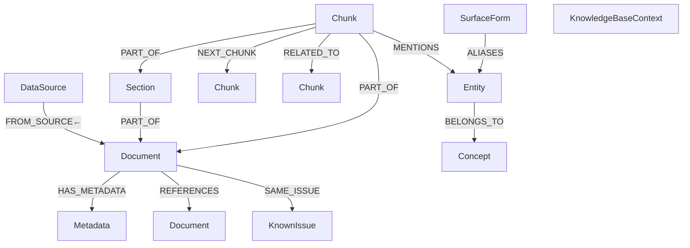

# Agentic Graph-RAG Support System Prototype

A stateful, agentic Retrieval-Augmented Generation system that answers support queries
against a **Neo4j** knowledge graph. The pipeline fuses three retrieval strategies
(dense / BM25 / graph-PPR) plus optional web search, reranks with a cross-encoder under
outcome-signal modulation, gates context quality with **CRAG**, and runs an iterative
reasoning loop (**PIVOT** — Plan · Inspect · eVOlve · Verify) before generating a cited
answer. When it cannot answer, it **defers** with a structured payload that an **A2A**
voice agent turns into a clarifying question.

**Stack:** Neo4j 5.26 · LangGraph · vLLM (Qwen3.6 chat · Qwen3-Embedding-8B · BGE-reranker-v2-m3) ·
A2A SDK · MCP · Tavily/Brave/Parallel web search

> A deeper design document lives in [docs/ARCHITECTURE.md](docs/ARCHITECTURE.md). Where the two
> disagree, this README reflects the current code (it was regenerated from a source scan).
> See [§ Node Catalogue](#node-catalogue) and [§ Hyperparameters](#hyperparameters-configpy).

---

## Table of Contents

1. [File / Folder Structure](#file--folder-structure)
2. [Code Ownership](#code-ownership)
3. [Graph Database — Node Types & Relationships](#graph-database--node-types--relationships)
4. [ETL & Search Pipelines (visualised)](#etl--search-pipelines)
5. [Node Catalogue](#node-catalogue)
6. [Hyperparameters (config.py)](#hyperparameters-configpy)
7. [A2A / MCP Documentation](#a2a--mcp-documentation)
8. [Running the System](#running-the-system)
9. [License](#license)
10. [Citation](#citation)

---

## File / Folder Structure

```
Prototype_v1.0/
├── config.py                 # Central config — all constants, loaded from .env (single source of truth)
├── graph_builder.py          # LangGraph StateGraph assembly + compile(); PIVOT and legacy pipelines
├── run.py                    # CLI: run one query through the pipeline
├── diagnose.py               # Connectivity + embedding-dimension health check
├── redeploy.sh               # Rebuild + restart the docker stack after code changes
├── query.sh / test_ingest_ticket.sh   # Convenience shell wrappers
│
├── data/                     # Datasets (git-ignored bulk): tickets CSV, WixQA subsets, KB corpus
│
├── graph/
│   ├── neo4j_client.py       # Driver wrapper + AUTHORITATIVE schema DDL (setup_schema, reset_vector_index)
│   ├── schema.cypher         # Index/constraint reference only (dims are illustrative — config.EMBED_DIM wins)
│   └── __init__.py
│
├── etl/                      # Ingestion pipeline
│   ├── ingest.py             # ETL orchestrator (CLI) — single-file and paired two-file mode
│   ├── download_wixqa.py     # Downloads WixQA subsets + KB corpus from Hugging Face → data/
│   ├── schema_detector.py    # LLM column/archetype detection + detect_paired_schemas()
│   ├── chunker_v3.py         # ChunkData + make_chunks() — DETERMINISTIC metadata-as-text prefixes (no LLM)
│   ├── chunker_v2.py         # Legacy chunker (kept for reference; ingest uses v3)
│   ├── embedder.py           # vLLM embedding dispatcher (Qwen3-Embedding-8B), batched
│   ├── ner_v2.py             # LLM + regex entity extraction + SurfaceForm synonym expansion
│   ├── metadata_builder.py   # Structured fields → Metadata nodes; entity → Concept mapping
│   ├── sage_builder.py       # SAGE RELATED_TO cross-chunk edge builder (cosine ANN, offline)
│   ├── known_issue_builder.py# Clusters similar tickets → (:KnownIssue) + SAME_ISSUE edges
│   ├── doc_enrichment.py     # Document-only enrichment: heading paths, section/doc summaries, lineage
│   ├── pdf_parser.py         # PDF → structured sections (heading-ratio heuristics)
│   ├── paperless_client.py   # Paperless-ngx REST client (paginated list, metadata, PDF download)
│   ├── paperless_ingest.py   # Paperless-ngx document ingest entrypoint
│   └── ticket_ingest.py      # Single-ticket live ETL (used by the A2A /ingest-ticket endpoint)
│
├── agents/                   # LangGraph nodes (one node ≈ one file)
│   ├── state.py              # AgentState TypedDict + ScoredChunk + reducers (_add_or_reset)
│   ├── llm.py                # Chat + embedding dispatcher (vLLM: Qwen3.6 chat, Qwen3-Embedding-8B)
│   ├── retrieval_utils.py    # Shared ANN + BM25 Cypher helpers + metadata filter
│   ├── kb_context.py         # Loads KnowledgeBaseContext singleton; cached prompt injection
│   ├── metadata_vocab.py     # Canonical vocabularies (STATUS, PRIORITY, CHANNEL, …)
│   ├── metadata_normalization.py  # Deterministic clean-up of planner-produced metadata filters
│   ├── ablation.py           # Per-query ablation overrides (state.ablation dict)
│   ├── pivot_log.py          # Unified [PIVOT] decision logging (greppable)
│   │
│   ├── memory_context_builder.py  # Splits raw mem0 memories into typed lists
│   ├── memory_query_rewriter.py   # Rewrites sub_queries using user memory context
│   ├── failed_attempt_extractor.py# per_user_failed / resolved / global_failed signals
│   │
│   ├── query_decomposer.py   # Splits compound queries into ≤4 sub-queries
│   ├── planner.py            # PIVOT PLAN — structured plan dict (intent, arms, budgets)
│   ├── query_expander.py     # Paraphrase + HyDE expansion per sub-query
│   ├── intent_classifier.py  # Legacy — only used when PIVOT_ENABLED=false
│   │
│   ├── ticket_fasttrack.py   # Pre-planner ANN on problem/question chunks (seeds RRF)
│   ├── ticket_reuse_gate.py  # KnownIssue ANN fast-path gate
│   ├── ticket_retriever.py   # Parallel arm: similar tickets from support history
│   │
│   ├── semantic_retriever.py # Dense HNSW vector search
│   ├── bm25_retriever.py     # Neo4j Lucene full-text (BM25)
│   ├── graph_retriever.py    # Surface-form → entity seeds → KNN-guided PPR
│   ├── web_search_retriever.py # Brave / Tavily / Parallel web search arm
│   ├── rrf_fusion.py         # Reciprocal-Rank-Fusion of all retrieval arms
│   ├── reranker.py           # Cross-encoder rerank + optional metadata boost
│   ├── outcome_score_modulator.py # Score adjustment from failed/resolved/reuse signals
│   │
│   ├── crag_grader.py        # Pure scorer: recall + precision → context_quality
│   ├── inspect_node.py       # PIVOT INSPECT — routing + monotonic rule
│   ├── evolve_node.py        # PIVOT EVOLVE — adaptive retry, resets hit lists
│   ├── verify_node.py        # PIVOT VERIFY — final sub-goal coverage check
│   ├── react_loop.py         # react_thinker · react_actor · react_observer
│   ├── reflact_loop.py       # reflact_thinker (state-reflective variant)
│   ├── generator.py          # Cited answer synthesis; reads partial_answer_note
│   └── deferral_handler.py   # Emits structured A2A deferral payload
│
├── a2a/                      # A2A server (serves the pipeline as a JSON-RPC agent)
│   ├── main.py               # Starlette app + routes; serves on :8015
│   ├── executor.py           # AgentExecutor bridging A2A tasks → LangGraph; deferral lifecycle
│   ├── ingest_endpoint.py    # POST /ingest-ticket — fetch ticket via MCP get_ticket → ETL
│   ├── .well-known/agent-card.json  # A2A agent discovery card (skills, interfaces)
│   ├── test_client.py        # Sample A2A client
│   └── requirements.txt
│
├── evaluate/                 # Benchmark + evaluation suite
│   ├── wixqa.py              # WixQA benchmark runner (per-query + aggregate logging)
│   ├── eval.py               # 4-layer eval CLI (retrieval / ragas / routing / sweep)
│   ├── paper_metrics.py      # WixQA §4.3 metrics: F1/BLEU/ROUGE + Factuality/Context-Recall judges
│   ├── retrieval_metrics.py  # P@k / R@k / MRR / NDCG
│   ├── ragas_runner.py       # RAGAS Faithfulness / Correctness / Context-Recall
│   ├── single_shot.py        # One-off query inspection
│   ├── appendix_stats.py / analyze_report.py / probe_missing_articles.py  # Paper appendix tooling
│   └── paper_appendix/       # A1–A5 appendix markdown (results, judge prompts, repro, hyperparams)
│
├── wixqa-dms-ingestion/      # Side project: render WixQA KB → PDFs → Paperless-ngx DMS
│   └── scripts/ src/ docker/ # PDF generation, Paperless setup, ingestion
│
├── scripts/                  # Smoke tests / inspection utilities (see scripts/README.md)
├── docs/                     # Design doc, diagrams (.puml/.svg) and paper figures
│   ├── ARCHITECTURE.md       # Long-form design doc (partly superseded by this README)
│
├── Dockerfile / docker-compose.yml   # neo4j + graph-rag-agent services
├── requirements.txt          # Python deps
├── .env.example              # Template for .env — copy and fill in
└── .env                      # API keys + backend selection (NOT committed)
```

---

## Code Ownership

Ownership below is derived from **`git blame` on surviving lines** (who wrote the code
that currently exists), not raw commit counts. Per-file attribution is available from
git history:

```bash
git blame --line-porcelain <file> | grep '^author ' | sort | uniq -c | sort -rn
```

### Overall (current Python lines)

| Identity | Lines | Share |
|---|---|---|
| `janis` | 9,198 | ~55% |
| Co-author | 7,053 | ~42% |
| *(uncommitted working tree)* | ~400 | ~2% |

Total ≈ 16,600 lines across 90 tracked `.py` files.

### Ownership by area

| Area | Primarily owned by |
|---|---|
| PIVOT core (`planner`, `inspect_node`, `evolve_node`, `verify_node`, `react_loop`, `crag_grader`) | `janis` |
| Retrieval core (`semantic_retriever`, `graph_retriever`, `rrf_fusion`, `query_*`) | `janis` |
| `evaluate/` benchmark suite (all files) | `janis` |
| Most of `etl/` (`embedder`, `ner_v2`, `sage_builder`, `metadata_builder`, `ingest`, `schema_detector`) | `janis` |
| `graph/neo4j_client.py`, `run.py`, `config.py` | `janis` |
| Memory / ticket / metadata agents (`memory_*`, `ticket_retriever`, `ticket_reuse_gate`, `metadata_*`, `deferral_handler`, `reflact_loop`, `web_search_retriever`, `outcome_score_modulator`, `ablation`, `failed_attempt_extractor`) | Co-author |
| Paperless / PDF ETL (`paperless_client`, `paperless_ingest`, `pdf_parser`, `chunker_v3`, `doc_enrichment`, `known_issue_builder`) | Co-author |
| Entire `wixqa-dms-ingestion/` tree and all `scripts/check_*.py` | Co-author |
| Shared / contested (`reranker`, `generator`, `bm25_retriever`, `a2a/executor`, `state`) | mixed ~50/50 |

> The `janis` share corresponds to Janis Poggemann; the co-author is a second contributor
> on the project team.

---

## Graph Database — Node Types & Relationships

The knowledge graph is layered: **Source → Document → (Section) → Chunk → Entity/Concept**,
with a parallel **Metadata** layer and **reuse** nodes (`KnownIssue`). Embeddings live on
`Chunk` (retrieval) and `KnownIssue` (reuse fast-path).



### Node Types

| Label | Key properties | Layer | Notes |
|---|---|---|---|
| `DataSource` | `id`, `name`, `type` (`ticket_system`\|`qa_forum`\|`kb_article`\|`document`), `schema_detected` | Source | One per ingested dataset |
| `Document` | `id`, `source_id`, `title`, `doc_type`, `status`, `created_at`, `updated_at` | Document | `id` = SHA-256 for KB articles |
| `Metadata` | `id`, `doc_id`, `key`, `value`, `value_type` (`str`\|`int`\|`date`\|`enum`) | Metadata | Structured filter layer |
| `Section` | `id`, `doc_id`, `heading`, `level`, `position` | Structure | Only for long/PDF docs |
| `Chunk` | `id`, `text`, `chunk_type`, `chunk_index`, `embedding` (float[`EMBED_DIM`]), `context_prefix`, `token_count` | Chunk | **Embedding = embed(`context_prefix` + text)** |
| `Entity` | `id`, `name`, `type`, `source`, `confidence` | Entity | products, error codes, components, … |
| `SurfaceForm` | `id`, `form` (lowercased alias) | Entity | Query-time entity resolution |
| `Concept` | `id`, `label`, `description` | Concept | Abstract grouping of entities |
| `KnownIssue` | `id`, `problem_embedding` (float[`EMBED_DIM`]), `resolution_notes`, `ticket_count` | Reuse | Centroid of ≥3 similar tickets (cosine ≥ 0.85) |
| `KnowledgeBaseContext` | `id` (`"kb_context"`), `organisation_name`, `domain_description` | Context | **Singleton** written once at ETL time |

> **`KnowledgeBaseContext`** is injected into CRAG / INSPECT / ReAct / generator prompts so
> they understand KB scope (e.g. "this is a Wix KB") and don't penalise vocabulary synonyms.
> **`KnownIssue`** drives the `ticket_reuse_gate` ANN fast-path before the full retrieval stack.

### Relationship Types

| Relationship | Direction | Properties | Purpose |
|---|---|---|---|
| `PART_OF` | Chunk → Document | — | Chunk belongs to document |
| `PART_OF` | Section → Document | `position` | Section belongs to document |
| `PART_OF` | Chunk → Section | `position` | Chunk inside section |
| `HAS_METADATA` | Document → Metadata | — | Structured metadata layer |
| `NEXT_CHUNK` | Chunk → Chunk | `relation_type` (`problem_resolution`\|`sequential`\|`qa`) | Sequential / logical flow |
| `MENTIONS` | Chunk → Entity | `confidence`, `method` | NER link |
| `RELATED_TO` | Chunk ↔ Chunk | `score`, `method` (`sage_semantic`) | SAGE cross-chunk semantic edges |
| `ALIASES` | SurfaceForm → Entity | — | Surface form → canonical entity |
| `BELONGS_TO` | Entity → Concept | `confidence` | Entity → abstract concept |
| `FROM_SOURCE` | Document → DataSource | — | Provenance |
| `REFERENCES` | Document → Document | — | Cross-dataset link (QA answer → KB article) |
| `SAME_ISSUE` | Document → KnownIssue | `similarity_score` | Ticket belongs to a known-issue cluster |

### Indexes & Constraints (applied at runtime by `neo4j_client.setup_schema()`)

| Index | Type | Purpose |
|---|---|---|
| `chunk_embedding` | HNSW vector, cosine, `EMBED_DIM` | Semantic retrieval |
| `known_issue_embedding` | HNSW vector, cosine, `EMBED_DIM` (`problem_embedding`) | KnownIssue ANN for reuse gate |
| `chunk_fulltext` | Lucene full-text on `[text, context_prefix]` | BM25 keyword retrieval |
| `chunk_hop_index` | Composite `(id, chunk_index)` | Fast graph traversal |
| `metadata_lookup` | Composite `(key, value)` | Metadata pre-filtering |
| `entity_name_index` | B-tree `name` | Entity lookup |
| `surface_form_index` | B-tree `form` | Surface-form → entity resolution |
| `doc_type_index` | B-tree `doc_type` | Cross-dataset REFERENCES traversal |
| `known_issue_ticket_count` | B-tree `ticket_count` | KnownIssue ranking |
| `doc_id_unique` · `chunk_id_unique` · `entity_id_unique` · `concept_id_unique` · `metadata_id_unique` · `section_id_unique` · `surface_form_unique` · `kb_context_unique` · `known_issue_id` | Uniqueness constraints | Deduplication |

> ⚠ The vector-index dimension is **not** taken from `schema.cypher` — it is written at
> runtime from `config.EMBED_DIM`. Switching embedding backends changes the dimension and
> requires `reset_vector_index()` + a re-ingest.

---

## ETL & Search Pipelines

### ETL Pipeline (ingest)

```
Input dataset (CSV / JSON / JSONL / Markdown / PDF / Paperless)
        │
        ▼
 SchemaDetector ............. LLM inspects columns + sample rows
        │                     → ColumnMapping + DatasetProfile (ticket | qa | kb_article)
        ▼
 _load_and_filter() ......... generic loader; dedup on id; filter by status
        │
        ▼
 make_chunks (chunker_v3) ... 1 chunk (KB body) | 2 chunks (Q+A) | N chunks (sectioned body)
        │                     DETERMINISTIC context_prefix (metadata-as-text, NO LLM)
        │                     embed_text = context_prefix + "\n\n" + text
        ▼
 EntityExtractor (ner_v2) ... LLM + regex entities → SurfaceForm aliases (LLM synonyms in --entity-mode full)
        │
        ▼
 MetadataBuilder ............ structured fields → Metadata nodes; entity → Concept
        │
        ▼
 embed_chunks (embedder) .... vLLM Qwen3-Embedding-8B, batched (EMBED_BATCH_SIZE)
        │
        ▼
 SAGEGraphBuilder ........... cosine ANN top-K per chunk → RELATED_TO {method:"sage_semantic"}
        │                     SAGE_PERCENTILE + SAGE_MIN_SCORE floor, capped at SAGE_MAX_EDGES
        ▼
 [tickets] KnownIssue ....... cluster cosine≥0.85, ≥3 members → (:KnownIssue) + SAME_ISSUE
        │
        ▼
 [paired] REFERENCES ........ primary.ref_field → secondary.id → REFERENCES (Document→Document)
        │
        ▼
 Neo4j batch writes (UNWIND, NEO4J_BATCH_SIZE=500)
   DataSource → Document → Metadata → Section → Chunk → Entity → SurfaceForm → Concept
   → PART_OF → HAS_METADATA → NEXT_CHUNK → MENTIONS → ALIASES → BELONGS_TO → RELATED_TO → REFERENCES
```

### Search / Query Pipeline (PIVOT, `PIVOT_ENABLED=true`)

```
                         USER QUERY
                             │
                  memory_context_builder        (split mem0 → typed lists)
                             ▼
                    query_decomposer             (≤4 sub-queries)
                             ▼
                    ticket_fasttrack             (ANN on problem/question chunks → may SEED rrf)
                             ▼
                    ticket_reuse_gate ──ki_fast_path──► inspect_node
                             │ (no KI match)
                             ▼
                    memory_query_rewriter
                             ▼
                       planner (PLAN)            (intent · sub_goals · arm flags · budgets)
                             ▼
                    query_expander               (paraphrase + HyDE, gated on plan.use_hyde)
                             │
        ┌──────────────── plan-conditioned PARALLEL fan-out ────────────────┐
        ▼          ▼          ▼            ▼            ▼              ▼
   semantic_     bm25_     surface_     graph_     web_search_     ticket_
   retriever    retriever  form†        retriever  retriever       retrieval_node
        └──────────┴──────────┴────────────┴────────────┴──────────────┘
                             ▼
                      rrf_fusion (k=60)          (injects fasttrack_hit / reuse_candidates)

   † surface_form is not a standalone node — it is the SurfaceForm-index lookup arm
     inside graph_retriever (activated by plan.use_surface_form / the surface_form
     EVOLVE strategy). Shown here as its own arm for clarity.
                             ▼
                 failed_attempt_extractor        (per_user_failed / resolved / global_failed)
                             ▼
                        reranker                 (cross-encoder + optional metadata boost)
                             ▼
                  outcome_score_modulator        (penalise failed, boost resolved/reuse)
                             ▼
                  crag_grader (PURE SCORER)       context_quality = 0.7·recall + 0.3·precision
                             ▼
                   inspect_node (INSPECT) ──────────────────────────────┐
        ┌──────────┬──────────────┬──────────────┬─────────┐            │
   skip_evolve  reflact/react   evolve          defer       │            │
        │          │              │               │         │            │
        │     reasoning loop   evolve_node   deferral_handler│           │
        │     (thinker→actor→  (reset hits,        │  →END   │           │
        │      observer)        retry a single      │        │           │
        │          │            retriever arm) ─────┘ back to rrf_fusion ─┘
        └──────────┴────────────► verify_node (VERIFY)
                                       │
                          ┌────────────┴───────────┐
                          ▼                        ▼
                      generator               deferral_handler ──► END
                   (cited JSON answer)         (A2A gap payload)
                          │
                         END
```

EVOLVE maps each strategy back to one retriever (`bm25_retry`/`surface_form`→bm25,
`graph_hop`→graph, `semantic_requery`→semantic, `web_search`→web, `defer`→deferral) and
re-enters the chain at `rrf_fusion`.

A strong fast-track match only *seeds* RRF (`fasttrack_hit`); it never bypasses the
generator. `ticket_retrieval_node` is part of the parallel fan-out and its results land in
`similar_tickets`. The legacy `intent_classifier` path is preserved behind `PIVOT_ENABLED=false`.

---

## Node Catalogue

| Node | File | Responsibility |
|---|---|---|
| `memory_context_builder` | memory_context_builder.py | Splits raw mem0 results into typed views (profile / preference / interaction / ticket_ref). No-op when empty |
| `query_decomposer` | query_decomposer.py | LLM splits compound queries into ≤4 sub-queries; atomic queries pass through |
| `ticket_fasttrack` | ticket_fasttrack.py | ANN restricted to `chunk_type IN [problem, question]`; ≥ `FASTTRACK_SIMILARITY_THRESH` follows `[:NEXT_CHUNK]` to resolution + CRAG grades. Strong match **seeds** rrf (never bypasses generator); weak match cleared |
| `ticket_reuse_gate` | ticket_reuse_gate.py | ANN over `KnownIssue` centroids. ≥ `KI_FAST_PATH_SIM_THRESH` → CRAG grade; combined ≥ `TICKET_REUSE_THRESHOLD_HIGH` → `ki_fast_path=True` → `inspect_node`. Mid-score (≥ `TICKET_REUSE_THRESHOLD_MID`) → `reuse_candidates` for RRF boost |
| `memory_query_rewriter` | memory_query_rewriter.py | Enriches sub_queries with user profile/preference context. No LLM call when memory lists empty |
| `planner` **(PLAN)** | planner.py | One LLM call → plan dict: intent, sub_goals, arm flags (`use_semantic`/`bm25`/`graph`/`web_search`/`surface_form`/`ticket_retriever`/`hyde`), `skip_reflact`, `react_budget`, `confidence_target`, failure_modes. Emits `[PIVOT] PLAN` |
| `intent_classifier` | intent_classifier.py | Legacy — only wired when `PIVOT_ENABLED=false` |
| `query_expander` | query_expander.py | 3 paraphrase variants per sub-query + HyDE hypothetical answer (gated on `plan.use_hyde`) → `expanded_queries` + `hyde_query` |
| `semantic_retriever` | semantic_retriever.py | Dense HNSW vector search + metadata pre-filter; on retry uses `crag_missing_hint` as leading query |
| `bm25_retriever` | bm25_retriever.py | Neo4j Lucene full-text (`context_prefix`+`text`), min-max normalised; metadata hard/soft filtering |
| `graph_retriever` | graph_retriever.py | Surface-form extraction (regex + SurfaceForm index, no LLM) → entity seeds → KNN-guided PPR over NEXT_CHUNK + RELATED_TO + MENTIONS (damping 0.75, 20 iters) |
| `web_search_retriever` | web_search_retriever.py | Brave / Tavily / Parallel; results as `chunk_type="web_result"` with `WEB_SEARCH_TRUST_PENALTY` |
| `ticket_retrieval_node` | ticket_retriever.py | ANN over problem/question ticket chunks → `similar_tickets` (threshold 0.60, top_k 10) |
| `rrf_fusion` | rrf_fusion.py | RRF (k=60) merge of semantic + BM25 + graph + web; injects `fasttrack_hit` / `reuse_candidates` |
| `failed_attempt_extractor` | failed_attempt_extractor.py | LLM extracts `per_user_failed` / `resolved` from interaction memories; `global_failed` from KnownIssue ANN |
| `reranker` | reranker.py | `BAAI/bge-reranker-v2-m3` cross-encoder (vLLM). Keeps top-`RERANKER_TOP_K`; optional `_metadata_rescore` boost (gated `RERANK_BOOST_ENABLED`); reuses `reranker_score_cache` on retries |
| `outcome_score_modulator` | outcome_score_modulator.py | Penalises `per_user_failed` (×0.3) / `global_failed` (×0.6), boosts `resolved` (×1.4) / `reuse_candidates` (×1.2). Clamped to [`OUTCOME_SCORE_MIN`, `OUTCOME_SCORE_MAX`]. Gated `OUTCOME_MODULATOR_ENABLED` |
| `crag_grader` | crag_grader.py | **Pure scorer.** One LLM call → recall + precision → `context_quality` = 0.7·recall + 0.3·precision. Writes `crag_verdict` (hint only) + `crag_missing_hint`. Routing owned by INSPECT |
| `inspect_node` **(INSPECT)** | inspect_node.py | 3-question reflection; **skip_reflact gate** + **monotonic rule** (EVOLVE only when strategy untried AND `expected_improvement=true`). Gap reasons: `wrong_terms`/`wrong_tool`/`kb_insufficient`/`irrecoverable`. Emits `[PIVOT] INSPECT` |
| `evolve_node` **(EVOLVE)** | evolve_node.py | Records strategy in `tried_strategies`, increments `crag_retries`, **resets** hit lists (`_add_or_reset(None)`). Emits `[PIVOT] EVOLVE` |
| `verify_node` **(VERIFY)** | verify_node.py | Marks each sub_goal satisfied/partial/missing. **Trusts CRAG**: if `context_quality ≥ CRAG_SUFFICIENT_THRESH` never defers, only sets `partial_answer_note`. Routes generate / defer. Emits `[PIVOT] VERIFY` |
| `react_thinker` / `react_actor` / `react_observer` | react_loop.py | Thought → tool dispatch → dedup + goal check; routes to verify_node |
| `reflact_thinker` | reflact_loop.py | State-reflective variant with running `reflection_summary` (used when `USE_REFLACT=true`) |
| `generator` | generator.py | Final LLM call — cited multi-hop synthesis. Idempotency guard; reads `partial_answer_note` |
| `deferral_handler` | deferral_handler.py | Emits structured A2A payload (`deferral_reason`: type/gaps/covered/suggested_clarification). Types: `out_of_domain`, `irrecoverable_gap`, `irrecoverable_gap_after_retry` |
| `pivot_log` *(helper)* | pivot_log.py | Unified `[PIVOT]` logger — every routing decision is greppable |

---

## Hyperparameters (config.py)

All constants live in [config.py](config.py), each env-overridable via `.env`.
Defaults below are the **current code defaults**.

### Backends (vLLM)

Each model role picks its provider independently. The **code defaults** are the
low-friction local ones; the **reported runs** used vLLM (or the LiteLLM gateway) —
see [evaluate/paper_appendix/A3_reproduction.md](evaluate/paper_appendix/A3_reproduction.md).

| Var | Code default | Used for reported runs | Effect |
|---|---|---|---|
| `EMBED_BACKEND` | `ollama` | `vllm` | Embedder — selects `EMBED_DIM` |
| `CHAT_BACKEND` | `litellm` | `vllm` / `litellm` | Chat/LLM backend for all generative nodes |
| `RERANKER_BACKEND` | `local` | `vllm` | Cross-encoder reranker |
| `JUDGE_MODEL` | `""` | `gemma-4-31b-it` | Optional neutral judge for paper metrics (empty → use chat model) |
| `EMBED_DIM` | *derived* | 4096 | Resolved from the active backend (`ollama` → 768, `vllm`/`litellm` → 4096) |

> ⚠ `EMBED_DIM` must match the model the index was built with. Switching embedding
> backend after ingest invalidates the vector index — re-ingest, or retrieval silently
> degrades.

| Role | Model | Endpoint |
|---|---|---|
| Chat | `qwen3.6-35b-a3b` (FP8) | `localhost:8010` (`VLLM_CHAT_*`) |
| Embed | `Qwen/Qwen3-Embedding-8B` (4096-dim) | `localhost:8011` (`VLLM_EMBED_*`) |
| Reranker | `BAAI/bge-reranker-v2-m3` | `localhost:8012` (`VLLM_RERANKER_*`) |

> Requires `ssh gpu-server` with `LocalForward 8010/8011/8012` active. See config.py §vLLM.

### Retrieval & fusion

| Var | Default | Effect |
|---|---|---|
| `RETRIEVAL_TOP_K` | 20 | Candidates each arm returns into RRF (raising 20→60 tested, did **not** help — see config note) |
| `RERANKER_TOP_K` | 10 | Chunks kept after cross-encoder |
| `RRF_K` | 60 | RRF rank-smoothing constant |
| `FUSION_POOL_SIZE` | 30 | RRF-fused pool passed to the reranker |
| `GRAPH_SEED_K` | 3 | Top semantic hits used as PPR seeds |
| `GRAPH_HOP_DEPTH` | 2 | Subgraph hop depth (`*1..N`) |
| `GRAPH_MAX_SEEDS` | 40 | Hard cap on entity-anchored PPR seeds (prevents adjacency blow-up) |
| `GRAPH_MIN_UNIGRAM_LEN` | 5 | Min token length for SurfaceForm unigram lookup |

### SAGE (ETL-time edge builder)

| Var | Default | Effect |
|---|---|---|
| `SAGE_ENABLED` | true | Build RELATED_TO edges at ingest |
| `SAGE_TOP_K_PER_CHUNK` | 5 | Neighbours per chunk (production: 50) |
| `SAGE_MIN_SCORE` | 0.88 | Hard floor for SAGE edges |
| `SAGE_PERCENTILE` | 95 | Percentile threshold within candidates |
| `SAGE_MAX_EDGES` | 5000 | Absolute cap (prototype safety) |

### CRAG / PIVOT routing

| Var | Default | Effect |
|---|---|---|
| `PIVOT_ENABLED` | true | Master switch (false → legacy intent_classifier path) |
| `CRAG_SUFFICIENT_THRESH` | 0.80 | "Good enough" — VERIFY never defers above this |
| `CRAG_RETRY_THRESH` | 0.30 | Below this → hard defer (unless recoverable + retries remain) |
| `CRAG_MAX_RETRIES` | 3 | Max EVOLVE cycles before forced deferral |
| `CRAG_SKIP_REACT_THRESH` | 0.92 | Skip reasoning loop entirely → VERIFY |
| `CRAG_PRECISION_TOP_N` | 5 | Precision judged over top-N reranked passages only |
| `CRAG_DEFERRAL_PARTIAL_THRESH` | 0.35 | Deferral handler attempts a partial answer at/above this |
| `INSPECT_REQUIRE_IMPROVEMENT` | true | Monotonic rule — EVOLVE only when `expected_improvement=true` |
| `VERIFY_MIN_COVERAGE` | 0.5 | Sub-goal coverage to proceed to generator (non-CRAG-sufficient path) |
| `ALLOW_DEFERRAL` | true | false → suppress deferral (forces EVOLVE/best-effort; useful for single-turn benchmarks) |
| `USE_REFLACT` | true | Use reflact_thinker instead of plain react_thinker |
| `REACT_MAX_ITERATIONS` | 2 | Hard cap on ReAct/ReflAct cycles |
| `PLAN_DEFAULT_REACT_BUDGET_FACTUAL` / `_MULTI_HOP` | 1 / 2 | Default ReAct budget per intent |
| `PLAN_DEFAULT_CONFIDENCE_FACTUAL` / `_MULTI_HOP` | 0.75 / 0.65 | Per-query CRAG target per intent |

### Ticket fast-track & reuse gate

| Var | Default | Effect |
|---|---|---|
| `FASTTRACK_SIMILARITY_THRESH` | 0.82 | Min cosine on problem/question chunk to attempt fast-track |
| `FASTTRACK_HARD_SKIP_THRESH` | 0.85 | (legacy constant — hard-skip path removed from the graph) |
| `FASTTRACK_SEED_THRESH` | 0.70 | CRAG combined to seed fast-track hit into RRF |
| `KI_FAST_PATH_SIM_THRESH` | 0.85 | KnownIssue ANN similarity to attempt CRAG grade |
| `TICKET_REUSE_THRESHOLD_HIGH` | 0.70 | CRAG combined floor to trigger `ki_fast_path` |
| `TICKET_REUSE_THRESHOLD_MID` | 0.40 | Floor to add a candidate to `reuse_candidates` |

### Outcome score modulator

| Var | Default | Effect |
|---|---|---|
| `OUTCOME_PENALTY_PER_USER` | 0.30 | Multiplier for solutions this user already failed with |
| `OUTCOME_PENALTY_GLOBAL` | 0.60 | Multiplier for globally-failed solutions |
| `OUTCOME_BOOST_RESOLVED` | 1.40 | Multiplier for solutions that helped this user |
| `OUTCOME_BOOST_REUSE` | 1.20 | Multiplier for `reuse_candidates` |
| `OUTCOME_SCORE_MIN` / `_MAX` | 0.05 / 1.00 | Clamp after modulation |
| `OUTCOME_KNOWN_ISSUE_THRESH` | 0.75 | KnownIssue ANN threshold for `global_failed` |

### Context-engineering ablation switches (default **off** — used for ablation studies)

| Var | Default | Effect |
|---|---|---|
| `METADATA_IN_GENERATOR_ENABLED` | false | Inject metadata headers into the generator prompt |
| `METADATA_FILTER_ENABLED` | false | Retrieval-time metadata pre-filter |
| `RERANK_BOOST_ENABLED` | false | Reranking-time metadata boost |
| `MEMORY_ENABLED` | false | Memory-conditioned query rewriting |
| `REUSE_GATE_ENABLED` | false | KnownIssue / similar-ticket fast-path gate |
| `OUTCOME_MODULATOR_ENABLED` | false | Outcome-signal score modulation |

> These flags default to **false**. Enable the ones you want active in `.env`, or override
> them per query via `state["ablation"]` (see [agents/ablation.py](agents/ablation.py)).

### Metadata filtering

| Var | Default | Effect |
|---|---|---|
| `METADATA_FILTER_KEYS` | priority, category, product, status, channel, severity, doc_type, source_system, language | Fields the intent classifier may extract |
| `METADATA_HARD_KEYS` | `doc_type` | Hard-gate keys (non-match dropped); all others are soft ranking boosts |
| `METADATA_BOOST_WEIGHT` | 0.15 | Max multiplicative boost when all soft filters match |

### LLM temperatures

| Var | Default | Used by |
|---|---|---|
| `TEMPERATURE_STRUCTURED` | 0 | Planner, crag_grader, verify, inspect, decomposer (deterministic JSON) |
| `TEMPERATURE_GENERATE` | 0.1 | Generator (faithful but avoids repetition loops) |
| `TEMPERATURE_REASON` | 0.3 | reflact/react thinkers, observer, memory rewriter |
| `TEMPERATURE_EXPAND` | 0.5 | Query expansion / HyDE (diversity is the point) |

### Web search & ETL

| Var | Default | Effect |
|---|---|---|
| `WEB_SEARCH_ENABLED` | *see note* | Web search arm. **Note:** the code compares to `"false"`, so the literal default evaluates to **False** unless `WEB_SEARCH_ENABLED=false` is set (quirk in config.py) |
| `WEB_SEARCH_PROVIDER` | tavily | `brave` \| `tavily` \| `parallel` |
| `WEB_SEARCH_MAX_RESULTS` | 5 | Results per call |
| `WEB_SEARCH_TIMEOUT_S` | 10 | Request timeout |
| `WEB_SEARCH_TRUST_PENALTY` | 0.85 | Multiplier on web chunk scores (keeps KB chunks preferred) |
| `NEO4J_BATCH_SIZE` | 500 | Nodes per UNWIND batch |
| `EMBED_BATCH_SIZE` | 50 | Texts per embedding call |
| `PDF_HEADING_H1_RATIO` / `H2_RATIO` / `CAPTION_RATIO` | 1.5 / 1.15 / 0.85 | PDF heading detection font-size ratios |

---

## A2A / MCP Documentation

The agent is exposed as an **A2A** (Agent-to-Agent) JSON-RPC 2.0 service, served by
[a2a/main.py](a2a/main.py) on **port 8015**. It is designed to be driven by a **voice
agent** that speaks clarifications back to the user, and it ingests live tickets by calling
a ticket-system **MCP** server.

### Endpoints

| Method / Path | Purpose |
|---|---|
| `POST /` | A2A JSON-RPC task ingress (the search skill) |
| `GET /.well-known/agent-card.json` | A2A discovery card (skills, interfaces, examples) |
| `GET /health` | Liveness check → `{"status":"ok","version":"1.0.0"}` |
| `POST /ingest-ticket` | Fetch a ticket via MCP `get_ticket` and run it through ETL |

The agent card advertises one skill, `graph_rag_search`, at
`http://localhost:8015/` (`a2a/.well-known/agent-card.json`).

### Voice-agent query contract

Send a JSON string as the A2A message text:

```json
{
  "query": "How do I delete a payment method and set the currency for a course?",
  "user_id": "u-123",
  "ticket_id": "4567",
  "user_memories": [],
  "user_clarification": ""
}
```

Plain text is also accepted (treated as `query`). The executor returns an artifact
`graph_rag_result` with one of:

- **answered** — `{status:"answered", answer, confidence, crag_verdict, cited_chunk_ids}` → task `COMPLETED`.
- **deferred** — `{status:"deferred", deferral_reason:{type, gaps, covered, suggested_clarification}, …}` → task `INPUT_REQUIRED`.
- **deferred_final** — `irrecoverable_gap_after_retry` → task `FAILED` (escalate to human).

### Deferral lifecycle (handled in `a2a/executor.py`)

1. **First deferral** (`irrecoverable_gap` / `out_of_domain`): task → `INPUT_REQUIRED`. The
   voice agent speaks `deferral_reason.suggested_clarification` and collects more info.
2. **Retry**: the voice agent re-submits to the **same `context_id`** with
   `{"user_clarification": "..."}`. The executor reads the previous deferral from the
   `InMemoryTaskStore`, merges `original_query + clarification`, pre-seeds `evidence_gaps`
   and `crag_missing_hint`, and starts `crag_retries=1`.
3. **Final failure** (`irrecoverable_gap_after_retry`): task → `FAILED`; the voice agent
   reads the escalation message and hands off to a human.

Status updates stream during the run (`WORKING` messages at retrieval-done, ReAct start,
each ReAct iteration) so the caller can narrate progress.

### Ticket ingest via MCP (`POST /ingest-ticket`)

```jsonc
// request body
{ "ticket_id": "4567" }
```

The endpoint connects to the ticket-system MCP server (`streamable_http`), calls the
`get_ticket` tool with the integer id, and runs the result through
[etl/ticket_ingest.py](etl/ticket_ingest.py) (same ETL as bulk ingest → Document + Chunks +
Entities). It returns **202 Accepted** immediately; ETL runs in a background executor.

| Env var | Purpose |
|---|---|
| `TICKET_MCP_URL` | URL of the ticket-system MCP server, e.g. `http://host.docker.internal:8040/mcp/` |
| `TICKET_MCP_TOKEN` | Bearer token for the MCP server |
| `A2A_HOST` / `A2A_PORT` | Bind host/port (default `0.0.0.0:8015`) |

> The real ticket system expects an **integer** `ticket_id`; a UUID (created without the
> real system) cannot be fetched and returns a clear error.

---

## Running the System

### 0. Setup

```bash
# 1 - Python environment
python -m venv .venv && source .venv/bin/activate    # Windows: .venv\Scripts\activate
pip install -r requirements.txt

# 2 - Configuration: copy the template and fill in credentials + backend choice
cp .env.example .env
$EDITOR .env

# 3 - Evaluation data (not tracked in git; ~56 MB from the Hugging Face Hub)
python etl/download_wixqa.py --kb --subset expertwritten
```

The WixQA corpora and the derived BM25 index are deliberately untracked - see
[`data/README.md`](data/README.md) for what gets downloaded and where it comes from.

### 1. Start services

```bash
sudo docker compose up -d
sudo docker compose logs -f graph-rag-agent      # A2A agent logs
# Neo4j browser → http://localhost:7474   (bolt → 7687)
# A2A agent     → http://localhost:8015/health
```

`docker-compose.yml` runs **neo4j** (5.26-community, APOC) and **graph-rag-agent**
(the A2A service, depends on a healthy Neo4j). `.env` provides credentials + backend
selection. Local dev without Docker: `py a2a/main.py` (A2A) or `py run.py "<query>"` (CLI).

### 2. Health check

```bash
sudo docker compose exec graph-rag-agent python diagnose.py   # Neo4j connectivity + embed dim
```

### 3. Ingest data

`etl/ingest.py` is the orchestrator. Key flags: `--primary`/`--secondary` (paired mode),
`--clear` (wipe first), `--limit`/`--secondary-limit`, `--articles` (only KB articles
referenced by the primary set), `--distractor-sample N` (keep a realistic haystack),
`--entity-mode full|fast` (fast = regex only, no LLM synonyms), `--no-embed`, `--no-sage`,
`--detect-only`.

```bash
# Full paired ingest — QA + referenced KB articles (recommended)
sudo docker compose exec graph-rag-agent \
  python etl/ingest.py \
    --primary  data/wixqa_expertwritten.csv \
    --secondary data/wix_kb_corpus.csv \
    --articles --clear --limit 5000 --entity-mode fast

# Fast dev run with hard limits on both datasets
sudo docker compose exec graph-rag-agent \
  python etl/ingest.py \
    --primary  data/wixqa_expertwritten.csv \
    --secondary data/wix_kb_corpus.csv \
    --clear --limit 200 --secondary-limit 200 --entity-mode fast

# Inspect detected schemas without writing
sudo docker compose exec graph-rag-agent \
  python etl/ingest.py \
    --primary data/wixqa_expertwritten.csv \
    --secondary data/wix_kb_corpus.csv --detect-only
```

> `--articles` alone shrinks the haystack and inflates retrieval scores. For a *valid* but
> faster KB, add `--distractor-sample 2000 --distractor-seed 42`. Always report corpus size —
> reduced-KB scores are **not** comparable to full-KB runs.

WixQA datasets are fetched via `python etl/download_wixqa.py --subset synthetic --kb`
(subsets: `expertwritten` (200), `simulated` (200), `synthetic` (6 221)).

### 4. Test queries

```bash
# CLI (one-shot)
sudo docker compose exec graph-rag-agent python run.py "My login keeps failing"
sudo docker compose exec graph-rag-agent python run.py -q "How do I reset my password?" --json

# Trace PIVOT routing decisions
sudo docker compose exec graph-rag-agent python run.py "..." 2>&1 | grep '\[PIVOT\]'
# → PLAN → INSPECT → (EVOLVE | REACT | REFLACT) → VERIFY → (GENERATE | defer)

# Via A2A (voice-agent contract)
python a2a/test_client.py
```

### 5. Benchmarks (WixQA)

```bash
# Default ExpertWritten, top-k = 5 (Retrieval + Answer + Routing + Cost metrics)
sudo docker compose exec graph-rag-agent python -m evaluate.wixqa --k 5

# Switch subset
sudo docker compose exec graph-rag-agent \
  python -m evaluate.wixqa --dataset data/wixqa_synthetic.csv --k 5

# Smoke test first N rows + LLM answer-quality (RAGAS)
sudo docker compose exec graph-rag-agent python -m evaluate.wixqa --limit 20 --ragas

# Reproduce WixQA paper §4.3 metrics (F1/BLEU/ROUGE + Factuality + Context-Recall judges)
sudo docker compose exec graph-rag-agent \
  python -m evaluate.wixqa --dataset data/wixqa_expertwritten.csv --paper-metrics
```

Outputs a per-query CSV (`evaluate/results_<subset>_<timestamp>.csv`, includes full answer +
judge rationales) and an aggregate `*.summary.json`.

Complementary 4-layer eval CLI:

```bash
python -m evaluate.eval --layer retrieval   # P@k / R@k / MRR / NDCG (no LLM cost)
python -m evaluate.eval --layer ragas       # Faithfulness / Correctness / Context Recall
python -m evaluate.eval --layer routing     # CRAG verdict distribution + deferral rate
python -m evaluate.eval --layer sweep       # context-engineering ablation matrix + cost
```

### 6. Rebuild after code changes

```bash
sudo bash ./redeploy.sh
```

---

### Further reading

| Document | Contents |
|---|---|
| [docs/ARCHITECTURE.md](docs/ARCHITECTURE.md) | Long-form design doc (partly superseded by this README) |
| [docs/appendix_retrieval_stats.md](docs/appendix_retrieval_stats.md) | Corpus + retrieval-geometry statistics and the figures behind them |
| [docs/query_run_example_compound.md](docs/query_run_example_compound.md) | Annotated end-to-end trace of a compound multi-topic query |
| [evaluate/paper_appendix/](evaluate/paper_appendix/) | Appendices A1-A5: results, judge prompts, reproduction, hyperparameters |

Diagrams live in [docs/](docs/): `ETL Pipeline.svg` and `Graph Agent Flow.svg`, rendered
from the matching `.puml` sources in the same directory.

---

## License

Released under the [MIT License](LICENSE).

Note that the evaluation data (WixQA) is **not** covered by this license: it is
distributed by Wix under its own terms, and this repository downloads it at setup
time rather than vendoring it. See <https://huggingface.co/datasets/Wix/WixQA>.

## Citation

If you use this code, please cite the accompanying paper:

```bibtex
@misc{poggemann2026agenticgraphrag,
  author       = {Poggemann, Janis},
  title        = {Agentic Graph-RAG for Support Question Answering},
  year         = {2026},
  note         = {Prototype v1.0},
  howpublished = {\url{https://github.com/<user>/<repo>}}
}
```
