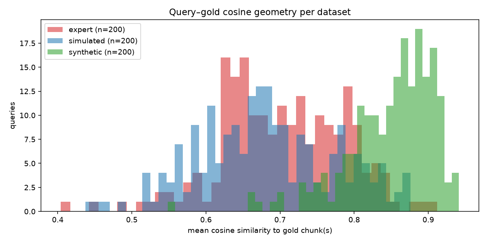
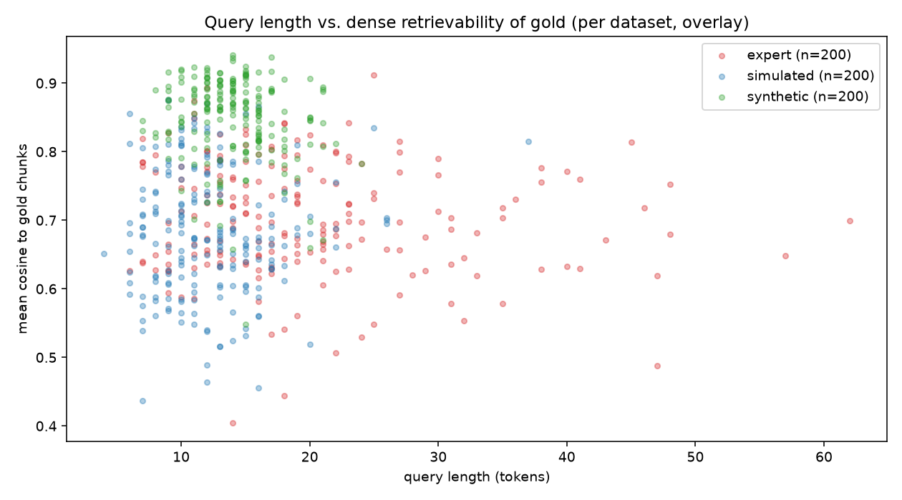
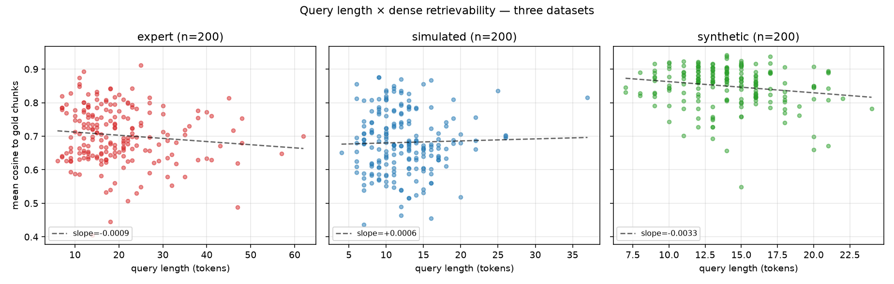
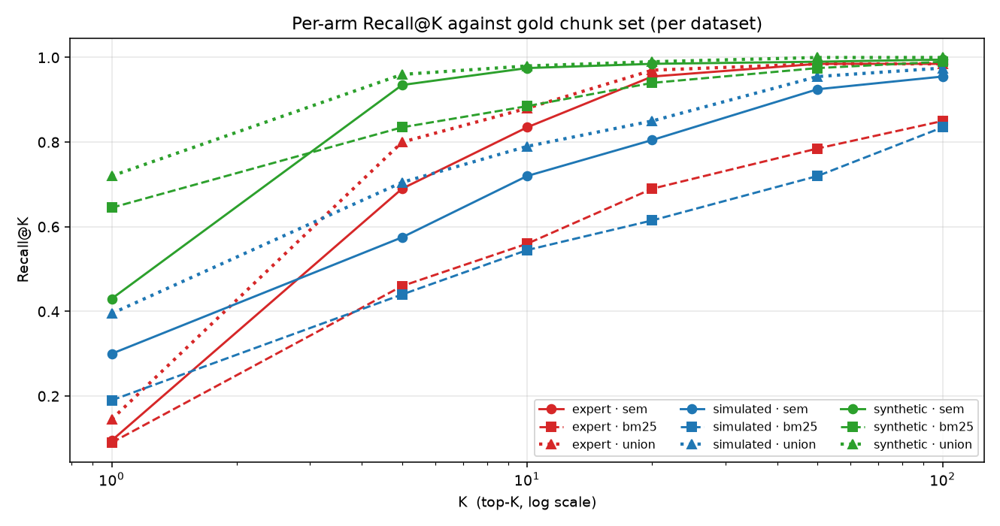
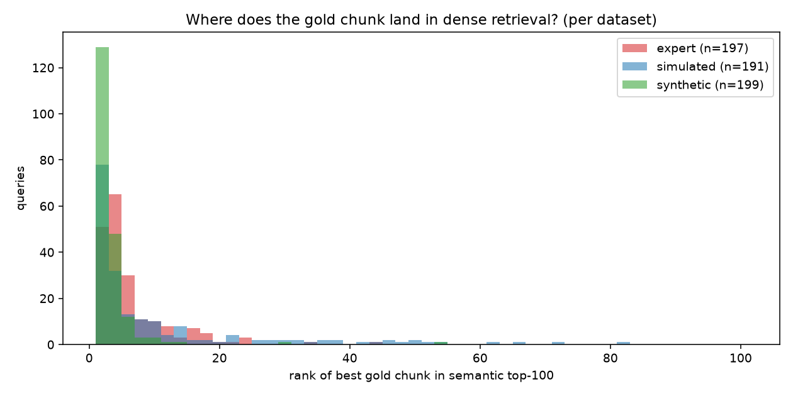

# Appendix — Retrieval-Side Statistics

This appendix characterises the corpus and the retrieval geometry of the three
WixQA evaluation splits used in this paper. Its purpose is to establish the
*upper bounds* against which the end-to-end system is later measured, rather
than to report end-to-end performance.

All numbers are produced by `evaluate/appendix_stats.py` from the live Neo4j
graph and the three WixQA CSVs (`expert`, `simulated`, `synthetic`), 200
queries per split (n = 600). Raw outputs live in
`evaluate/results/appendix/{corpus_stats.json, per_query.jsonl, per_query.csv,
query_aggregate.json, summary.md}`.

> **Note on a prior reporting error.** Earlier drafts of this appendix
> reported an expert hard ceiling of 0.74 and concluded "expert tells a
> coverage story." That number was an artefact of the evaluation script
> failing to split WixQA's compound multi-article gold keys (one entry
> encoding 2–3 separate articles concatenated as a 128- or 192-char hex
> string) before resolving them in the graph. After fixing the resolver
> (`expand_article_ids` in `appendix_stats.py`), every gold article in all
> three splits is recoverable from the corpus — the hard ceiling is 100 %
> across all datasets. The retrieval scores below are the corrected numbers.

---

## A. Corpus

The corpus comprises the indexed Wix Help-Center articles plus their derived
graph (SAGE `RELATED_TO` edges between chunks, `MENTIONS` edges from chunks to
entities, `ALIASES` edges from surface forms to entities).

| Quantity | Value |
|---|---:|
| Documents | 11,557 |
| Chunks | 25,550 |
| Entities | 8,856 |
| SurfaceForm nodes | 57,798 |
| RELATED\_TO edges (SAGE) | 3,079 |
| MENTIONS edges | 100,658 |
| NEXT\_CHUNK edges | 13,993 |

| Distribution (sample) | mean | median | std | min | max | n |
|---|---:|---:|---:|---:|---:|---:|
| Chunk token count | 172.1 | 45.0 | 299.9 | 2 | 5,144 | 5,000 |
| Embedding L2 norm | 1.000 | 1.000 | 0.000 | 1.000 | 1.000 | 5,000 |
| SAGE degree / chunk | 0.241 | 0.0 | 0.700 | 0 | 25 | 25,550 |
| MENTIONS in-degree / entity | 11.37 | 3.0 | 147.77 | 2 | 9,713 | 8,856 |
| SurfaceForms / entity | 6.53 | 7.0 | 3.31 | 1 | 17 | 8,856 |

**Reading the corpus shape.** The chunk-length distribution is heavily
right-skewed: median 45 tokens, mean 172, max 5,144. SAGE produces a sparse
graph (median degree 0) — most chunks have no semantic-edge neighbours, so
PPR-style propagation is concentrated on a small minority of hub chunks. The
MENTIONS in-degree distribution has a heavy tail (std ≫ mean) consistent with
a small number of hub entities being referenced by many chunks. Embedding L2
norms are uniformly 1.0 — embeddings are normalised at write time, so cosine
and dot-product retrieval are interchangeable.

---

## B. Query–gold geometry

For each evaluation query we (i) embed the question with the production
embedder, (ii) resolve every `gold_article_id` to its `Document` node
(splitting WixQA compound keys into their 64-char component hashes first),
(iii) collect every `Chunk` of those documents and its embedding, and (iv)
compute cosine similarity between the query and each gold chunk.

### B.1 Headline geometry

- Queries evaluated: **600**
- Queries with at least one embedded gold chunk: **600** (100 %)
- Queries with zero resolved gold documents: **0**

| Combined distribution | mean | median | std | min | max | n |
|---|---:|---:|---:|---:|---:|---:|
| Mean cosine(query, gold) | 0.744 | 0.748 | 0.109 | 0.404 | 0.941 | 600 |
| Max cosine(query, gold) | 0.782 | 0.790 | 0.101 | 0.468 | 0.953 | 600 |
| Query token count | 15.44 | 14.0 | 7.36 | 4 | 62 | 600 |
| Gold chunks / query | 3.29 | 3.0 | 1.81 | 2 | 13 | 600 |

| Dataset | n | n with gold | mean cos (mean) | max cos (mean) | query len (mean) |
|---|---:|---:|---:|---:|---:|
| expert | 200 | 200 | 0.703 | 0.750 | 19.9 |
| simulated | 200 | 200 | 0.681 | 0.719 | 12.3 |
| synthetic | 200 | 200 | 0.849 | 0.876 | 14.1 |

*Figure B.1 — Per-query mean cosine(query, gold) on each dataset. Synthetic is
cleanly separated above 0.8; expert and simulated overlap in the 0.6–0.8 band.
Synthetic queries are paraphrases of the article text, so embeddings align by
construction. Expert and simulated are natural-language phrasings of real
support questions and sit in the regime where retrieval choices matter most.*

### B.2 Corpus coverage (gold-ID resolution)

After applying the compound-ID splitter, every gold article in every split
resolves to at least one indexed `Document`.

| Dataset | n | zero docs resolved | zero gold chunks | fully resolved | hard ceiling |
|---|---:|---:|---:|---:|---:|
| expert | 200 | 0 | 0 | 74.0 % | **100.0 %** |
| simulated | 200 | 0 | 0 | 100.0 % | **100.0 %** |
| synthetic | 200 | 0 | 0 | 100.0 % | **100.0 %** |

*Every query in every split has at least one gold chunk in the
corpus. The `fully resolved` column for expert reports 74 % because some
expert queries reference 2–3 articles and not all components map to distinct
`Document` nodes after normalisation. This does not lower the recall ceiling
— every query has at least one gold chunk in the corpus and is therefore
fully recoverable in principle.*

> **Why this matters.** The Recall@K numbers below are reported against a
> 1.00 ceiling on every split. Differences between splits reflect real
> retrieval geometry (how easily the query embeds near the gold chunk), not
> ingest gaps.

### B.3 Query length × dense retrievability

Pearson correlations between query length (in tokens) and three signals:
mean cosine to gold, semantic hit\@10, BM25 hit\@10.

| Dataset | r(qlen, cos̄) | r(qlen, hit\@10 sem) | r(qlen, hit\@10 bm25) |
|---|---:|---:|---:|
| **combined** | −0.10 | +0.01 | +0.03 |
| expert | −0.11 | +0.01 | +0.12 |
| simulated | +0.03 | −0.03 | +0.04 |
| synthetic | −0.18 | −0.06 | +0.04 |

*Figure B.3 — All three datasets overlaid. No global trend is visible: the
clusters separate by dataset, not by query length within a dataset.*

*Figure B.4 — Same data split into three panels with an OLS reference line.
All slopes are small (|r| ≤ 0.18). Query length is not a strong predictor of
dense retrievability on any of the three splits — the dominant variance comes
from how lexically the question paraphrases the article, not from how many
tokens were used.*

> **Implication.** A query-rewriter or HyDE step that primarily targets short
> queries would not address the dominant source of retrieval miss in this
> corpus. The retrieval gap is lexical/semantic mismatch, not length.

---

## C. Per-arm Recall@K (raw query, no fusion, no rerank)

Each query is run independently through the semantic ANN index
(`chunk_embedding`, HNSW, top-100) and the BM25 fulltext index
(`chunk_fulltext`, top-100). A hit at K means at least one gold chunk lies in
the top-K of that arm. The *union* column reports the same metric on the set
union of the two arms — this is the upper bound for any fusion (RRF) or
reranker that consumes both arms.

### C.1 Combined

| K | Semantic ANN | BM25 | Union (fusion ceiling) |
|---:|---:|---:|---:|
| 1 | 0.275 | 0.308 | 0.420 |
| 5 | 0.733 | 0.578 | 0.822 |
| 10 | 0.843 | 0.663 | 0.883 |
| 20 | 0.915 | 0.748 | 0.937 |
| 50 | 0.967 | 0.827 | 0.980 |
| 100 | 0.978 | 0.892 | 0.987 |

### C.2 Per dataset

| Dataset | arm | R\@1 | R\@5 | R\@10 | R\@20 | R\@50 | R\@100 |
|---|---|---:|---:|---:|---:|---:|---:|
| expert | semantic | 0.095 | 0.690 | 0.835 | 0.955 | 0.985 | 0.985 |
| expert | bm25 | 0.090 | 0.460 | 0.560 | 0.690 | 0.785 | 0.850 |
| expert | union | 0.145 | 0.800 | 0.880 | 0.970 | 0.985 | 0.985 |
| simulated | semantic | 0.300 | 0.575 | 0.720 | 0.805 | 0.925 | 0.955 |
| simulated | bm25 | 0.190 | 0.440 | 0.545 | 0.615 | 0.720 | 0.835 |
| simulated | union | 0.395 | 0.705 | 0.790 | 0.850 | 0.955 | 0.975 |
| synthetic | semantic | 0.430 | 0.935 | 0.975 | 0.985 | 0.990 | 0.995 |
| synthetic | bm25 | 0.645 | 0.835 | 0.885 | 0.940 | 0.975 | 0.990 |
| synthetic | union | 0.720 | 0.960 | 0.980 | 0.990 | 1.000 | 1.000 |

*Figure C.1 — Recall@K curves on a log-K axis. Solid = semantic, dashed =
BM25, dotted = union. Colour encodes dataset. Note that expert (red) climbs
steeply: from R@1 = 0.095 to R@20 = 0.955 to R@100 = 0.985. The 1.5 pp
plateau at the high end is the only retrieval headroom remaining on the
expert split for any post-retrieval method.*

### C.3 Rank of the best gold chunk

*Figure C.2 — Histogram of the rank at which the first gold chunk appears in
the semantic top-100. Synthetic and simulated concentrate at rank 1–5; expert
has a longer tail but the vast majority of queries still place at least one
gold chunk within the top-50.*

---

## D. Interpretation

Three dataset-specific phenomena drive the choice of evaluation framing in
the main paper.

**Expert tells a rank-promotion story, not a coverage or recall story.**
Semantic ANN already reaches **R@100 = 0.985** on expert — the corpus is
fully covered and dense retrieval recovers nearly everything. The
informative metrics on expert are not Recall@100 but the *low-K* numbers:
R@1 = 0.095, R@5 = 0.690, R@10 = 0.835. The challenge is to push gold
chunks from rank 20–50 up to rank 1–5, which is exactly what a cross-encoder
reranker, RRF fusion, and planner-driven arm selection are designed to do.
Fusion (union) lifts R@5 from 0.690 → 0.800 (+11 pp) and R@10 from
0.835 → 0.880 (+4.5 pp), confirming that both arms carry complementary
signal on this split.

**Simulated is the strict retrieval-improvement target.** Semantic R@10 =
0.720 and BM25 = 0.545 are both moderate, and the gap to union (0.790) is
the largest of any split at K = 10 (+7 pp over the best single arm). This is
where late-fusion contributes measurable recall above either arm alone, and
where end-to-end Recall@10 lift from PIVOT-driven retries is most likely to
show.

**Synthetic tells an arm-selection story.** At R@1, BM25 (0.645) beats
semantic (0.430) by **+21.5 pp**, because synthetic questions reuse article
phrasing and lexical overlap dominates. A planner that always defaults to
semantic on this split leaves 21 R@1 points unrecovered. Union pushes R@1
to 0.720 — a further +7.5 pp above the better single arm.

**Query length is not a useful planner signal.** All three datasets show
|r(qlen, cos̄)| ≤ 0.18 and |r(qlen, hit@10)| ≤ 0.14. A rewrite step
conditioned on length alone would not address the retrieval gap on any of
the three splits.

These observations motivate two design choices in the main paper.
End-to-end Recall@K is reported at K = 5 and K = 10 (where the retriever has
real headroom across all three splits) rather than at K = 100 (where the
ceiling is already saturated on expert and synthetic). Planner arm-selection
(Q2 in the introduction) is evaluated against the per-dataset arm imbalances
above — synthetic's BM25-first signature and simulated's union gap are the
clearest cases where a static "always semantic" baseline is suboptimal.
